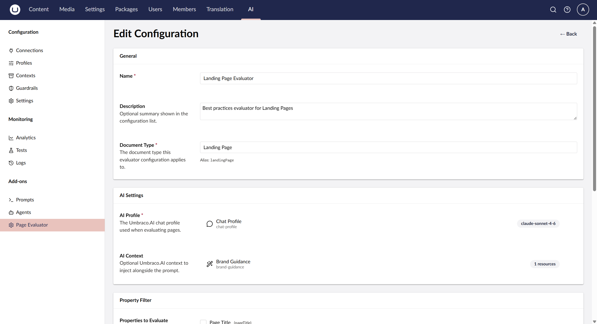
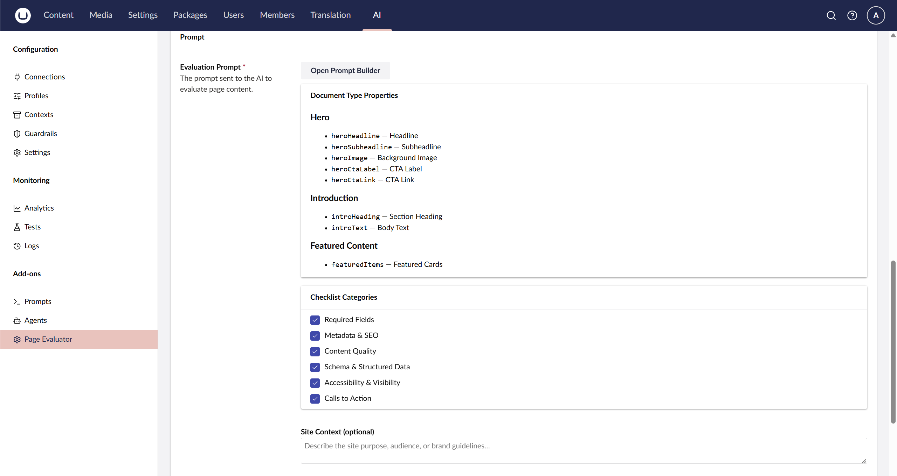
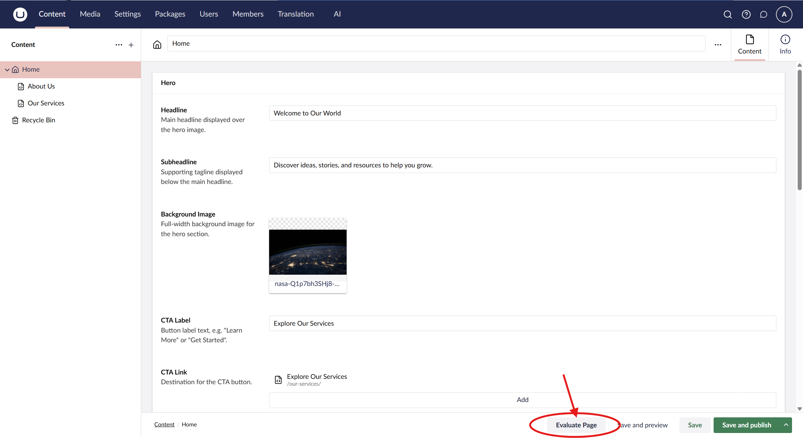
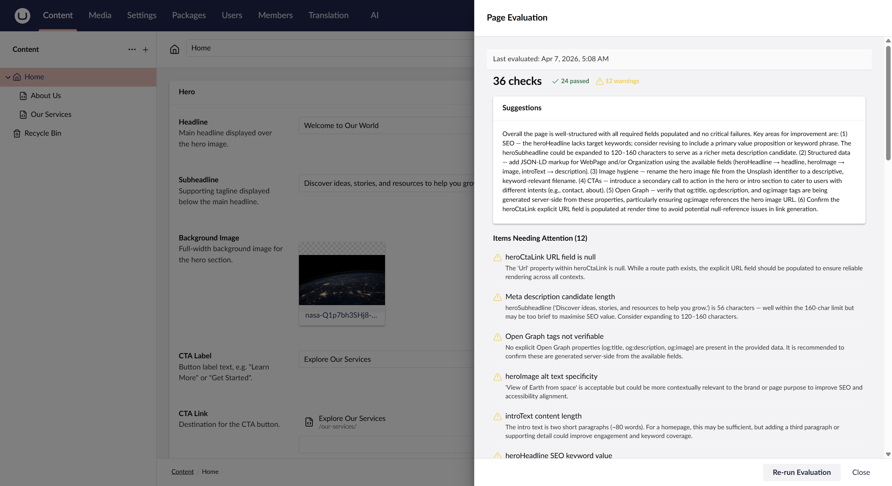
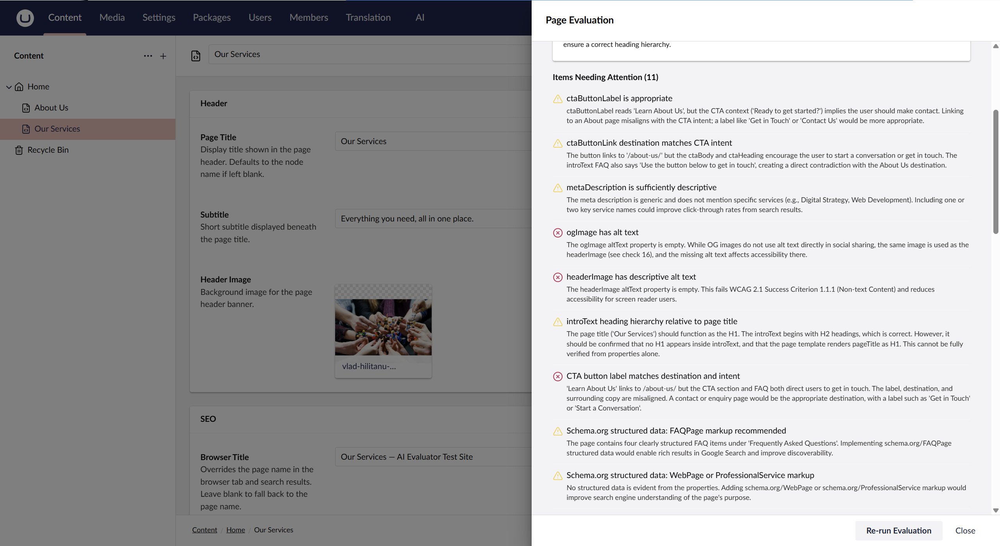
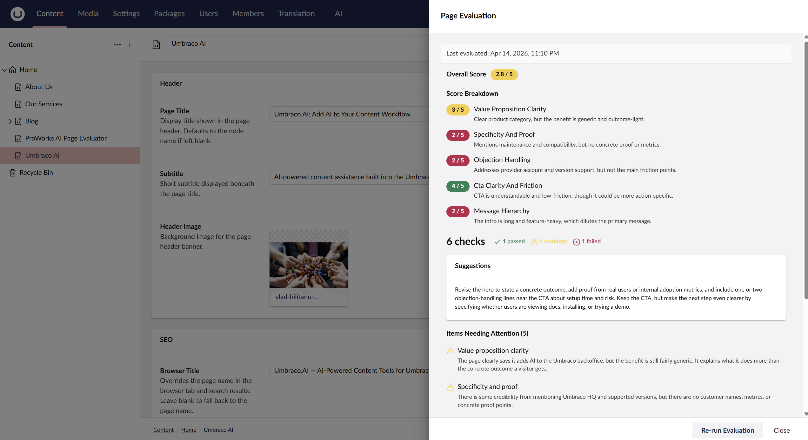
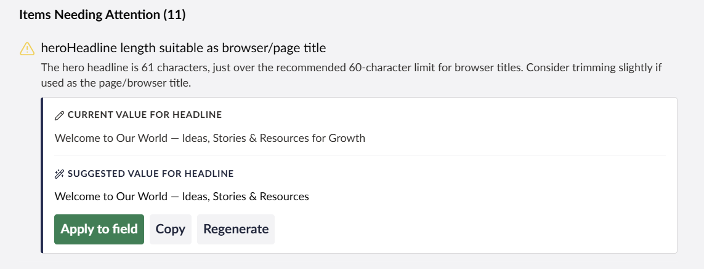

# ProWorks Umbraco AI Page Evaluator

[](https://www.nuget.org/packages/ProWorks.Umbraco.AI.PageEvaluator/)
[](https://www.nuget.org/packages/ProWorks.Umbraco.AI.PageEvaluator)
[](./LICENSE)

An Umbraco 17 backoffice package that adds an **Evaluate Page** button to the content editor toolbar. When clicked, it sends the current page's content to an AI model and returns a structured quality report directly inside the backoffice, including scored checks, warnings, and actionable suggestions.

---

## Features

- **One-click evaluation** from the document workspace toolbar
- **Structured report**: per-check pass / warn / fail status with explanations, overall score, and a suggestions summary
- **Evaluation caching**: results are cached per content node (and per language on multilingual sites), so re-opening the modal shows the previous result instantly with a timestamp. A **Re-run Evaluation** button forces a fresh AI call. Publishing or unpublishing a language clears only that language's cached result
- **Multilingual aware**: on a site with several languages, the evaluation covers the language you're viewing (plus shared, non-varying properties), recommendations are written in that language, and **Apply** writes only to that language's fields
- **Configurable per document type**: create named evaluator configurations with custom prompts in the Umbraco.AI Add-ons section; activate, edit, or delete configurations from the list view
- **Prompt Builder**: guided UI for generating evaluation prompts from document type properties and checklist categories
- **AI provider agnostic**: works with any profile configured in Umbraco.AI (Anthropic, OpenAI, etc.)
- **Property filtering**: optionally select which properties to include in evaluations to reduce token usage by excluding irrelevant fields
- **Rich property resolution**: uses Umbraco's Content Delivery API builder to send properly resolved property values (media alt text, block content, rich text as plain text, MNTP references) rather than raw editor format
- **Content cleaning**: HTML tags are stripped and long property values are truncated before sending to the AI, reducing token consumption
- **Draft-aware**: overlays unsaved text edits on top of the published content snapshot so unevaluated changes are included
- **AI text recommendations**: for any Fail or Warn check that targets a specific property, a **Generate recommendation** button fetches an AI-suggested replacement value. The recommendation box shows the property's current value alongside the suggestion so editors can compare before applying. Recommendations are property-editor-aware: plain text, Tags and **Rich Text** fields offer full apply + copy; complex fields such as media pickers and block lists are excluded automatically. For Rich Text with embedded blocks or media, Apply is only offered when the suggestion keeps every embedded item — otherwise you get Copy and an explanation, so embedded content is never lost. Third-party or custom property editors can be enabled for recommendations via `appsettings.json` (see [Configuration options](#configuration-options))
- **Guardrail policy support**: when the AI profile has guardrail rules that block an evaluation (pre- or post-generate), the modal shows a specific message identifying which policy fired rather than a generic error
- **Distinct AI failure messages**: transient provider overloads, rate limits, timeouts and aborted requests show a "temporarily unavailable, please retry" prompt; network/connectivity failures reaching the provider show a distinct connectivity message; authentication or configuration problems (e.g. an invalid AI connection credential) show a message directing editors to contact their administrator; gateway timeouts and unreachable gateways (proxies/CDNs in front of the backoffice) get their own messages — never a generic "fatal error"
- **Reliable structured output**: evaluations and recommendations ask the AI provider to enforce the expected JSON structure where it supports it, with an automatic one-time fallback to the tolerant parser for models that reject it
- **Security hardened**: admin-only config management, generic error responses (provider details are never leaked to the client), prompt injection defense, and per-user audit trail
- **Umbraco.AI Test Support**: fully supports multi-run tests and results evaluation to compare evaluations across models and package releases.
- **Copilot tools** (17.6.1): evaluate the open page, get check-based recommendations and apply one with approval, without leaving Copilot (see [Copilot and agents](#copilot-and-agents))
- **Umbraco Automate step** (17.6.1, optional add-on): an "Evaluate Page" step for review-before-release and publish-if-passing flows, with an email-ready report (see [Automate](#automate))
- **Umbraco Deploy support** (17.6.1, optional add-on): evaluator configurations move between environments with their AI profile and context (see [Deploy](#deploy))
- **One evaluation limit for every caller**: 10 evaluations or recommendations per minute per user, shared by the button, Copilot and agent tools. Since 17.6.1 it no longer depends on the host calling `app.UseRateLimiter()`

---

## Requirements

| Dependency | Version |
|---|---|
| Umbraco CMS | 17.8.0 or later 17.x |
| Umbraco.AI | 17.6.1 or later 17.x (Core/Startup; tested with Anthropic 17.1.3, OpenAI 17.3.1, Prompt 17.4.0, Agent 17.4.1, Agent.Copilot 17.2.0) |
| .NET | 10 |

**Upgrading from an earlier version of this package?** Package 17.6.0 requires Umbraco CMS 17.8.0+ and Umbraco.AI 17.6.1+ (and brings EF Core 10.0.12, which CMS 17.8 requires). Upgrade the platform first, then this package. The package depends on `Umbraco.Cms` 17.8.0+, so on an older site the install fails with `NU1605: Detected package downgrade: Umbraco.Cms from 17.8.0 to …`: upgrade the platform rather than working around that error. Sites that can't upgrade yet can stay on package 17.3.1 (CMS 17.6.2+ / Umbraco.AI 17.3.4+). Existing evaluator configurations and cached results are kept; any pending evaluation-cache migration runs on first start.

**Unattended installs:** use **17.3.1 or later** if your site installs or upgrades unattended alongside a package that publishes content during install (for example a starter kit such as Clean). Earlier versions could abort the unattended install with `no such table: umbracoAIEvaluationCache` ([#25](https://github.com/ProWorksCorporation/ProWorks-Umbraco.AI-Page-Evaluator/issues/25)); restarting the site worked around it.

---

## Getting Started

### 1. Install the package

Install via NuGet:

```bash
dotnet add package ProWorks.Umbraco.AI.PageEvaluator
```

Or search for **ProWorks.Umbraco.AI.PageEvaluator** in the NuGet Package Manager in Visual Studio.

Package page: https://www.nuget.org/packages/ProWorks.Umbraco.AI.PageEvaluator

### 2. Configure an AI profile

In the Umbraco backoffice, go to **AI > Connections** and **AI > Profiles** create or verify an AI profile with a connection.

### 3. Create an Evaluator Configuration

Go to **AI > Page Evaluator**.

1. Click **Create New**
2. Select the **Document Type** you want to evaluate
3. Choose the **AI Profile**
4. Optionally select specific **properties to evaluate** (if none are selected, all properties are sent)
5. Write or generate an evaluation prompt (use the **Prompt Builder** to auto-generate one from the document type's properties)
6. Optionally attach a **Context** resource from Umbraco.AI
7. Save and set the configuration to **Active**



The **Prompt Builder** lists the document type's properties and checklist categories, then generates a ready-to-use evaluation prompt:



### 4. Evaluate a page

Open any published content node of the configured document type. An **Evaluate Page** button appears in the workspace toolbar. Click it to run the evaluation.



The modal displays a structured report with scored checks, suggestions, and items needing attention:



Scroll down for detailed explanations of each check and actionable recommendations:



When dimensional scoring is enabled, the report also shows an overall score and a per-dimension breakdown with color-coded ratings:



When recommendations are enabled, the report allows the user to ask AI for a recommendation of the property value and apply it directly to the page.




---

## Configuration options

The package reads optional settings from `appsettings.json` under the `ProWorks:PageEvaluator` section.

### Additional recommendable editor aliases

By default only the built-in Umbraco editors listed above support recommendations. To enable recommendations for editors from third-party or custom packages, list their aliases in `appsettings.json`:

```json
"ProWorks": {
  "PageEvaluator": {
    "AdditionalRecommendableEditorAliases": [
      "MyPackage.CustomTextEditor",
      "AnotherPackage.SimpleText"
    ]
  }
}
```

Editors listed here are treated as plain-text fields and receive both the **Recommend** and **Apply** buttons in the evaluation modal. Alias comparison is case-insensitive. Built-in Umbraco editors (`Umbraco.TextBox`, `Umbraco.TextArea`, `Umbraco.Markdown`, `Umbraco.Tags`, `Umbraco.RichText`, `Umbraco.TinyMCE`) do not need to be listed here.

---

## Evaluation behaviour

### Saving cost on re-runs (Anthropic prompt caching)

Umbraco.AI 17.3 adds optional prompt caching for Anthropic profiles (**AI > Profiles > your profile > capability settings > Prompt caching**, `5m` or `1h`). The evaluator sends the same system prompt for every page of a document type, so enabling caching on the evaluator's profile can reduce input-token cost for repeated evaluations. Cached-token counts appear in Umbraco.AI's usage reporting.

### Usage and audit reporting

Evaluations and recommendations run under two different inline-chat aliases (`proworks-page-evaluator` and `proworks-page-evaluator-recommend`), so they appear as separate feature identities in the Umbraco.AI **audit log** and can be filtered separately. Since Umbraco.AI 17.6 the audit log also shows these aliases by name. Umbraco.AI's usage statistics group by provider, model, profile and user rather than by feature — to see evaluation and recommendation costs separately there, give each its own AI profile.

### AI profiles with their own system prompt

Since Umbraco.AI 17.5, a chat profile's own **System prompt** (AI > Profiles > your profile) is sent ahead of the evaluator's instructions on **every** call made through that profile, evaluations and recommendations included. A profile prompt such as "reply in a friendly, conversational tone" or "always reply in English" can therefore change the report, override the language a recommendation should be written in, or — on models that don't enforce the response format — stop the result from being read as a structured report. Umbraco.AI can only switch this behaviour off site-wide, which would also affect Copilot, prompts and agents, so the package leaves it on.

What the package does about it:

- The evaluator configuration screen shows a notice under the AI profile picker when the selected profile has its own system prompt. The notice is checked again every time you open a configuration, so it also appears if a prompt is added to the profile later.
- The evaluator's own instructions tell the model that their output format, language and tone rules take precedence over earlier instructions about tone, persona, language or format, and that report explanations and suggestions are written in a neutral, professional tone. Without this, a friendly-tone profile prompt made Claude add remarks such as "great work!" to report explanations. Because this rule comes last, it also applies if your own evaluator prompt asks for a different tone. It doesn't change the style of recommended field values.
- The package reads AI responses tolerantly: an answer wrapped in friendly text, closing remarks or extra code blocks is still read as a structured report or recommendation.

**Recommendation:** give the Page Evaluator a dedicated AI profile with **no** system prompt.

### AI disclosure notice

The evaluation report (and the raw AI output shown when a response can't be read as a report) displays Umbraco.AI's standard AI disclosure notice ("Responses are AI-generated and may be inaccurate."). It follows the site-wide **Disclosure notice** setting in Umbraco.AI: **Always** (the default, so editors see it after upgrading), **Dismissible** (an editor can dismiss it; the dismissal is remembered in their browser and covers the report and its recommendations), or **Off**.

### Scores may vary on some AI models

The evaluator asks for deterministic output (`temperature = 0`) so that re-running an evaluation on unchanged content gives the same scores. Since Umbraco.AI 17.3, providers declare which models accept that setting and Umbraco.AI silently drops it for the ones that don't — for example OpenAI's reasoning models (o-series, GPT-5) and newer Claude models. On those models, scores can differ between re-runs of the same page.

The package tells administrators when this applies: the evaluator configuration screen shows a notice under the AI profile picker when the selected profile's model ignores the setting. For the most repeatable scores, use a profile whose model supports temperature. Since 17.6.0 the report itself no longer shows this notice, so content editors aren't worried by something they can't act on; the API still returns `samplingSettingsIgnored` with each report.

---

## Copilot and agents

On sites with Umbraco.AI Agent / Copilot, the package adds three Copilot tools and one agent tool. No extra package is needed, and sites without the Agent packages ignore them. Editors can ask Copilot:

- **"How does this page score?"** Copilot evaluates the page that's open, using the values on screen (unsaved changes included) for the language being viewed, exactly like **Evaluate Page**. It returns the cached result when there is one and says when that result may be out of date. A fresh evaluation updates the cache, so the Evaluate Page report shows the same result.
- **"Fix the failing checks."** Copilot suggests values for fields named by failed or warning checks, wherever the report would offer **Generate recommendation**, and only when the configuration has recommendations enabled.
- **Applying a suggestion.** Copilot shows its approval prompt, then writes **exactly** the recommended value into the field (tags as separate tags, rich text with its embedded blocks kept, multilingual fields in the viewed language). The change is staged in the editor and **never saved**: the editor still clicks Save. Rich text that would lose an embedded block, read-only fields and suggestions made in another language are refused with a reason.

Agents that have no open page (for example an Automate "Run AI Agent" step) can use the **`evaluate_page`** tool, which evaluates a page's latest saved version by id, as the user the agent runs as, with Browse permission checked.

**Setup:** no agent gets these tools automatically. In **AI → Agents**, open the agent and grant the **Page Evaluator** tool scopes:
- **Read**: evaluate and recommend, plus `evaluate_page`
- **Write**: apply

Grant Read alone to let an agent evaluate without writing. Tool-initiated evaluations count towards the same 10-per-minute-per-user limit as the Evaluate Page button and appear in the audit log under the usual `proworks-page-evaluator` / `proworks-page-evaluator-recommend` names.

---

## Automate

The optional **ProWorks.Umbraco.AI.PageEvaluator.Automate** package adds an **Evaluate Page** step to [Umbraco Automate](https://umbraco.com/products/add-ons/automate/) 17.5.1+ (earlier Automate versions carry on after a failed step, so a failed evaluation could still be followed by a publish). The step evaluates the latest saved version of a page with its active evaluator configuration and outputs the overall score, a `passed` verdict, check counts and titles, a plain-text summary and an email-ready HTML report, in any of the package's 10 languages.

```bash
dotnet add package ProWorks.Umbraco.AI.PageEvaluator.Automate
```

Two typical flows:

- **Flow 1, review before release:** Content Saved → Evaluate Page → Send Email (body `${ steps.evaluate.reportHtml }`) → Request Approval → Switch on `approved` → Publish Content / Notify Editor. The gate only holds when release goes through the automation, e.g. when editors don't have the Publish permission.
- **Flow 2, publish pages that pass:** Content Saved → Evaluate Page with a **Pass threshold** (the report's 1–5 scale) → Switch on `${ steps.evaluate.passed }` → Publish Content, or Send Email + Request Approval → Publish / Notify Editor. **Fail on any failed check** is on by default (warnings never fail a page), and a threshold with no score in the report never passes. Branch on `passed` rather than comparing the score in a numeric Switch: Automate parses numbers with the server's culture, so `3.5` vs `3,5` matters.

The workspace's service account needs Browse on the pages (and Publish for flows that publish), and the report's "Open in Umbraco" link needs `Umbraco:CMS:WebRouting:UmbracoApplicationUrl`. Settings, outputs, error categories and both flows step by step: [Automate package README](src/ProWorks.Umbraco.AI.PageEvaluator.Automate/README.nuget.md).

---

## Deploy

The optional **ProWorks.Umbraco.AI.PageEvaluator.Deploy** package adds [Umbraco Deploy](https://umbraco.com/products/add-ons/deploy/) support (through Umbraco.AI.Deploy 17.3.1+). Evaluator configurations become Deploy schema items: each one, active or inactive, is written to `umbraco/Deploy/Revision` and moves to the next environment with its AI profile and context, like a document type. Install it on **every** environment.

```bash
dotnet add package ProWorks.Umbraco.AI.PageEvaluator.Deploy
```

- **What moves:** name, description, document type, AI profile and context (as dependencies), prompt, selected fields, scoring and recommendation settings, and the active state. Each environment keeps its own record fields (created date and creator; a deployed change counts as an edit with a blank modifier) and its own cached evaluations, which are cleared for the affected document types after a deploy.
- **The source's active state wins:** activating a configuration deactivates any other active one for that document type on the target; deploying an inactive configuration never activates another.
- **First deploy:** a single hand-made target configuration with the same document type and name (ignoring case and surrounding spaces) is adopted rather than duplicated. With several matches none is adopted, the configuration is added as new, and a warning is logged.
- **Deletes** reach an environment only when it runs Deploy's schema clean-up (`Umbraco:Deploy:Settings:PostDeploySchemaOperation: CleanSchema`, a `deploy-clean` trigger or the schema dashboard), and only configurations that came from a deploy are removed, never hand-made ones.
- **Automations** using the Evaluate Page step move with Automate's own Deploy support (`Umbraco.Deploy.Automate`).

Details: [Deploy package README](src/ProWorks.Umbraco.AI.PageEvaluator.Deploy/README.nuget.md).

---

## Contributing

See [README-DEV.md](README-DEV.md) for project structure, build instructions, architecture notes, and database migration commands.

---

## About ProWorks

<a href="https://www.proworks.com"></a>

[ProWorks Corporation](https://www.proworks.com/umbraco-platinum-partner/) is an **Umbraco Platinum Partner** and **Umbraco Contributing Partner** based in the USA. We have been building and maintaining Umbraco implementations since the early versions of the platform, certified across Umbraco 4 through 17, and we have three Umbraco MVPs on staff. Platinum status at ProWorks reflects sustained delivery quality, deep platform expertise, and ongoing community involvement through open-source packages, conference talks, and ecosystem advisory boards. This package is one example of that work.

 We work with organizations across many industries including credit unions, insurers, public agencies (federal, state, and local), travel, higher education, healthcare, and manufacturers. We have delivered projects for clients including NASA, Microsoft, University of Nevada-Reno, Co-op Solutions, USDA, and Cal Fire. Our approach is consultative: we will meet you where you are and recommend the right next step, even if that means doing less.

### AI Services

This open-source package evaluates individual pages on demand. ProWorks also offers a **site-wide Content Evaluator service** that analyzes how AI systems understand your organization across your entire website to support AEO and GEO success. We deliver an **AI Perspective Report** covering your AI-inferred positioning, value propositions, audience signals, and content consistency, based entirely on your publicly available content. As AI systems increasingly answer questions directly before anyone visits your site, understanding how you are interpreted at scale is a practical first step.

Learn more at [proworks.com/ai](https://www.proworks.com/ai).

### Get in Touch

If you have questions about this package, need help with an Umbraco project, or want to discuss the site-wide AI evaluation service, [contact us through our website](https://www.proworks.com/contact).

---

## License

MIT
